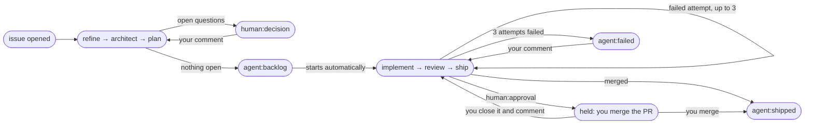

# agentic-sdlc

Python Copier template for a fully agentic software development life cycle. Your idea's in, merged Pull Requests out. AI Engineering project scaffold.

Copier-based Python 3.14 + UV project scaffold with typed config, structured logging, test
parity, GitHub Actions CI, and an agentic pipeline that takes a GitHub issue from idea to merged
PR — refine → architect → plan → implement → review → ship.

| Document | Holds |
|---|---|
| [`CONTEXT.md`](CONTEXT.md) | Glossary, Module Map, architectural constraints — what the project *is* |
| [`AGENTS.md`](AGENTS.md) | Standing instructions and skill index for AI agents |
| [`SECURITY.md`](SECURITY.md) | Secrets, accepted risks, and how to halt, override or roll back the agents |
| [`ISSUES.md`](ISSUES.md) | Issue format, estimate and priority scales, local backlog |
| [`docs/adr/`](docs/adr/ADR-000-template-architecture-decision.md) | This project's own Architecture Decision Records — ADR-000 is the blank form; your ADRs start at ADR-001 |

---

## Generate a project

Prerequisites: [uv](https://docs.astral.sh/uv/), [Task](https://taskfile.dev),
PowerShell 7+, and the GitHub CLI (`gh`).

```bash
uvx copier copy gh:architecture-that-works/agentic-sdlc path/to/new-project
```

Copier prompts for `project_name`, `description`, and `project_type` (`application` — the
default, `agent`, or `ml`). Then `uv sync` and `uv run pytest`.

To check the hello-world server: `docker build -t app:dev . && docker run --rm -p 8000:8000 app:dev`,
then open `http://localhost:8000` (project page) and `curl http://localhost:8000/healthz` (`ok`).
Replace `HelloHandler` in `src/main.py` with your first feature.

---

## Set up the pipeline

1. **Create a GitHub Project (v2)** with a single-select **Status** field: `Backlog`,
   `Implementing`, `Review`, `Shipped`. Optionally add **Estimate** (number) and **Priority**
   (single-select `P0`–`P4`).
2. **Fill `.env`** (copy `.env.example`): `GH_TOKEN`, `KANBAN_PROJECT_NUMBER`,
   `KANBAN_PROJECT_OWNER`.
3. **Add two repository secrets** (Settings → Secrets and variables → Actions): `GH_TOKEN` and
   `CLAUDE_CODE_OAUTH_TOKEN`. What each needs and how to rotate it: [`SECURITY.md`](SECURITY.md).
4. **Run `task setup`** — discovers the board's field IDs, writes them to `.env` and to repository
   variables, provisions the `agent:*` / `human:*` labels, and sets `KANBAN_RUNNER_PROFILE=hosted`.

---

## How the pipeline works

**The issue is the interface.** You write issues and comments, from a phone if you like; the
pipeline does the rest and writes everything it knows — brief, questions, decisions, plan,
attempts — into the issue body.



| When the issue has… | The pipeline is… | You… |
|---|---|---|
| no label | refining it (starts when the issue is opened) | nothing |
| `human:decision` | waiting on questions listed in the issue, each with a recommended answer (A), two alternatives (B, C) and "other" | reply in a comment: `ok` accepts every recommendation; `1B`, `2C` or `2: your own words` answer one question |
| `agent:backlog` → `agent:implementing` → `agent:reviewing` | building, reviewing and shipping it — `agent:backlog` starts it | nothing; comments you add are passed to the agent |
| `human:approval` (a held PR) | done and green, but the change touches governance files (agent instructions, CI, ADRs, security, skills) — set by ship, replacing `agent:reviewing`; comments here do not restart the pipeline | review and merge the PR — the issue then ships on its own; or close the PR and comment what should change |
| `agent:failed` | stopped after 3 failed attempts, each listed in the issue's **Attempts** section | fix it hands-on or explain what to change, then comment — any comment (e.g. `retry`) starts a new round of 3 attempts |
| `agent:paused` | waiting for the Claude usage allowance to reset; resumes on its own within 5 hours (checked hourly), no attempt counted | nothing |
| `agent:shipped` | done: merged and closed | nothing |

- **Your comment is the trigger.** Only comments from people with write access count, and
  never the pipeline's own (they start with 🤖 or ·). No @-mention or keyword is needed. Edits to
  the issue body do not trigger anything — add a short comment after editing.
- **Refine** writes an Agent Brief, Architecture Impact and Implementation Plan into the body,
  adds the issue to the board (in Backlog until it starts), and grants `agent:backlog` only
  when no question is open.
- **Failures retry themselves.** Test failures, review rejections, red CI (with its log) and
  refine errors (a self-grill that gives no usable answer included) each count as one attempt; the next attempt re-implements with every earlier
  failure in view. After 3 (`KANBAN_MAX_RETRIES`) the issue lands on `agent:failed`.
- **Labels are the pipeline's, not yours.** Write issues without labels. Refine sets
  `agent:backlog` or `human:decision`; ship sets `human:approval`.
- **Ship** waits for CI, then squash-merges and updates `CONTEXT.md` — unless the PR touches a
  governance file (the list is `GovernancePaths` in `lib/Config.ps1`), in which case it holds
  the PR for you and labels the issue `human:approval`. Adding that label yourself forces a hold.

**What needs you:**
[`human:decision`](../../issues?q=is%3Aopen+label%3Ahuman%3Adecision) ·
[held PRs](../../issues?q=is%3Aopen+label%3Ahuman%3Aapproval+label%3Aagent%3Areviewing) ·
[`agent:failed`](../../issues?q=is%3Aopen+label%3Aagent%3Afailed). To halt, override or roll back
anything, see [`SECURITY.md` § Human Oversight](SECURITY.md#human-oversight).

### Commands

Nothing needs a command day to day. These are for setup, backfill and local runs:

```bash
task afk               # cloud backfill: refine every issue with no agent:* label
task sync              # push ISSUES.md blocks to GitHub Issues (each is then refined)
task refine [ISSUE=N]  # local: refine one issue, or every issue with no agent:* label
task hitl [ISSUE=N]    # local: pick a backlog issue and run it in this terminal
task retry ISSUE=N     # resume a failed issue (same as commenting on it)
task setup             # one-time board, label and variable setup
task protect           # apply branch protection to main
```

Actions → **AFK** → **Run workflow** runs one stage — `refine` (issue `0` = backfill),
`implement` or `ship` — as a manual override.

### Runner profile

`KANBAN_RUNNER_PROFILE` (a repository variable) selects where the refine and implement jobs run:
`hosted` (default, `ubuntu-latest`) or `self-hosted` (a runner you register with the label
`gha-project`, with `uv`, `claude`, `git`, `gh` and `pwsh` installed). Switch with
`gh variable set KANBAN_RUNNER_PROFILE --body self-hosted`. `task afk` dispatches work — it does not
start a self-hosted runner. While the repository is public, do not switch to self-hosted — a self-hosted runner on a public repo allows fork pull request workflows to execute code on your machine.

---

## AI workflow

Every generated project ships the same six stages as skills in `.agents/skills/`, invoked
interactively in that order or run unattended by the orchestrator. Each skill prevents a class of
agent failure:

| Stage | Prevents |
|---|---|
| `refine` | Implementing before language and boundaries are agreed |
| `architect` | Changes with an unknown blast radius |
| `plan` | Coding without acceptance criteria, or re-proposing rejected ideas |
| `implement` | Untested code and shallow module design (method: TDD) |
| `review` | Regressions and principle violations reaching the merge |
| `ship` | Security gaps, supply-chain risk, lost architectural decisions |

The full skill index — including cross-cutting and domain skills — is in [`AGENTS.md`](AGENTS.md).

## Repository structure

```
src/                  application code — main.py, config.py, utils/ (generic m_*.py), tools/
tests/                pytest suite mirroring src/; README.md documents conventions
.agents/skills/       one directory per skill; README.md documents the lifecycle
.github/orchestrator/ the pipeline — stages/, engines/, lib/ (PowerShell module)
.github/tasks/        one runnable per Taskfile target
.github/checks/       validators run by checks.yml
.github/workflows/    checks.yml (CI gates), afk.yml (the pipeline), build, deploy
docs/adr/             this project's own ADRs — ADR-000 is the blank form; add ADR-001 onwards
```

The Module Map in [`CONTEXT.md`](CONTEXT.md) is the authoritative index.
